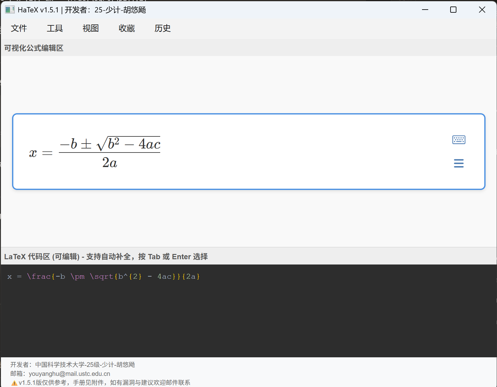
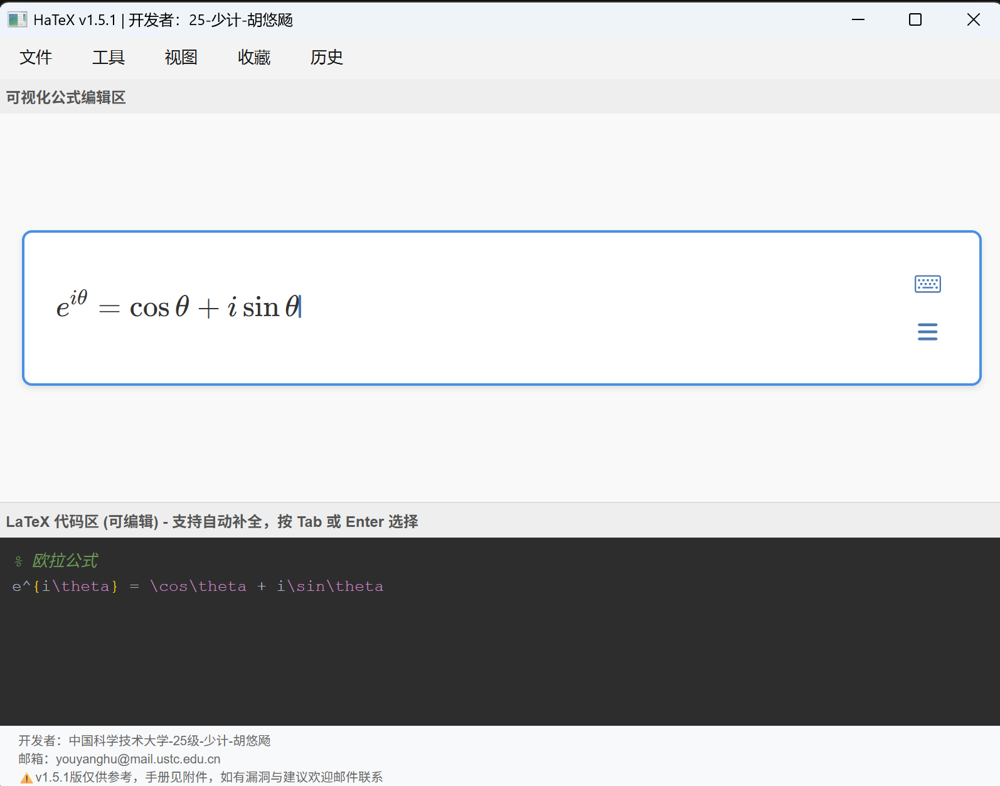

<div align="center">

[**简体中文**](README.zh-CN.md) | [**English**](README.en.md)

</div>

# HaTeX - BiDirectional LaTeX Editor

A desktop LaTeX formula editor built with PySide6 and MathLive, providing WYSIWYG visual editing with real-time bidirectional code synchronization.

## Screenshots

### Main Interface - Light Theme

*Bidirectional editing: visual formula area on top, LaTeX code area on bottom, synced in real time*

### Main Interface - Dark Theme

*Light/dark theme toggle for comfortable editing*

### Complex Formula

*Quadratic formula rendered in real time*

### Syntax Highlighting

*LaTeX commands, braces, numbers, and comments in distinct colors*

### Autocomplete

*Type `\` followed by a command name for smart suggestions (40+ commands)*

### Matrix Formatting

*Ctrl+Shift+F to auto-format matrix environments*

## Features

### Core
- **Visual Editing**: WYSIWYG formula editor powered by MathLive
- **Bidirectional Sync**: Real-time sync between visual formula and LaTeX code
- **Autocomplete**: Smart LaTeX command completion (40+ commands)
- **Matrix Formatting**: Auto-format matrix environments (pmatrix, bmatrix, vmatrix, etc.)
- **Syntax Highlighting**: Color-coded LaTeX code (commands, braces, numbers, comments)

### Advanced
- **Copy as Image**: One-click copy formula as PNG to clipboard (Ctrl+Shift+C)
- **Export**: Export as PNG or SVG/MathML
- **History**: Auto-save last 50 formulas for quick recall
- **Favorites**: Bookmark frequently used formulas for fast insertion
- **Drag & Drop**: Open .tex files by dragging into the window
- **Zoom**: Ctrl+scroll to zoom formula display (12px–72px)
- **Dark Theme**: Light/dark theme toggle
- **Multilingual**: Chinese/English interface with language switcher

### Editing
- **Smart Brackets**: Auto-complete bracket pairs
- **Shortcuts**: Rich keyboard shortcut support
- **Arrow Key Navigation**: Full arrow key support in formula area (left/right/up/down)
- **Chinese UI**: Complete Chinese interface and prompts
- **English UI**: Full English translation available

## Installation

### Requirements
- Python 3.8+
- PySide6
- MathLive 0.111.1 (included)

### Run from Source
```bash
pip install PySide6
python "HaTeX _v1.5.2.py"
```

### Standalone Executable
Download `HaTeX-v1.5.2-windows-x64.zip` from [Releases](https://github.com/youyanghu0508/BiDirectional-LaTeX-Editor/releases), extract, and double-click `HaTeX-v1.5.2.exe`. No Python installation required.

## Usage

### Basic
1. **Input formula**: Type directly in the visual formula area, or use the virtual keyboard
2. **Edit code**: Edit LaTeX code directly in the code area below
3. **Autocomplete**: Type `\` in the code area followed by a command name, press Tab or Enter to select
4. **Format matrix**: Select matrix code and press Ctrl+Shift+F

### Shortcuts

| Shortcut | Action |
|----------|--------|
| Ctrl+Shift+C | Copy as PNG image |
| Ctrl+Shift+E | Export as PNG |
| Ctrl+O | Open .tex file |
| Ctrl+S | Save as .tex file |
| Ctrl+D | Favorite current formula |
| Ctrl+Shift+F | Format matrix |
| Ctrl+= | Zoom in |
| Ctrl+- | Zoom out |
| Ctrl+0 | Reset zoom |
| Ctrl+Scroll | Zoom formula |

### Autocomplete Commands

40+ commonly used LaTeX commands, including:
- Fractions: `\frac`
- Roots: `\sqrt`, `\sqrtn`
- Integrals: `\int`, `\oint`
- Sum/Product: `\sum`, `\prod`
- Limits: `\lim`
- Greek letters: `\alpha`, `\beta`, `\gamma`, ...
- Trig functions: `\sin`, `\cos`, `\tan`
- Logarithms: `\log`, `\ln`, `\exp`
- Matrices: `\matrix`, `\bmatrix`, `\cases`
- Arrows: `\rightarrow`, `\leftarrow`, ...
- Set operations: `\in`, `\subset`, `\cup`, `\cap`
- Comparisons: `\le`, `\ge`, `\ne`, `\approx`

## Version History

### v1.5.2 (Current)
- **New**: Multilingual support (Chinese/English)
- **New**: Language switcher in menu (Language → 中文 / English)
- **New**: Language preference saved to config file
- **New**: Autocomplete descriptions translated to English

### v1.5.1
- **Fix**: Textarea scrolling issues (scrollbar drag, mouse wheel to bottom, ArrowDown to last line)
- **Fix**: Syntax highlight overlay scroll synchronization with textarea

### v1.5.0
- **New**: LaTeX syntax highlighting in code area (commands/braces/numbers/comments in distinct colors)
- **Fix**: Arrow key navigation in formula area (via JS capturing listeners + MathLive executeCommand API)
- **Fix**: Removed undocumented `smart-focus` attribute
- **New**: PyInstaller standalone executable support

### v1.4.0
- **New**: Copy as PNG image (Ctrl+Shift+C)
- **New**: Export PNG/SVG
- **New**: Formula history (last 50)
- **New**: Drag & drop .tex file open
- **New**: Favorites management
- **New**: Zoom control (Ctrl+scroll)
- **New**: Dark theme
- **Fix**: Matrix formatting extra rows
- **Fix**: Autocomplete cursor offset
- **Fix**: JS template injection vulnerability
- **Fix**: textarea↔math-field circular update
- **Fix**: Bracket completion not notifying Python
- **Upgrade**: MathLive v0.109.1 → v0.111.1

### v1.3.0
- Fixed 7 known bugs
- Improved stability

### v1.2.2
- Initial stable release

## Tech Stack

- **Backend**: Python 3.8+ / PySide6 (Qt 6)
- **Frontend**: HTML5 / CSS3 / JavaScript
- **Formula Engine**: MathLive 0.111.1
- **Architecture**: Single-file app (~1300 lines Python + embedded HTML/JS/CSS)

## Project Structure

```
HaTeX/
├── HaTeX _v1.5.2.py    # Main program (all code)
├── mathlive/            # MathLive library files
│   ├── mathlive.min.js
│   ├── mathlive-static.css
│   └── ...
├── hatex_history.json   # History (auto-generated)
├── hatex_favorites.json # Favorites (auto-generated)
└── hatex_config.json    # Config (language preference, auto-generated)
```

## Developer

**Youyang Hu (胡悠飏)**
University of Science and Technology of China, Special Class for the Gifted Young, Class of 2025
Email: youyanghu@mail.ustc.edu.cn

## License

This project is licensed under the [MIT License](LICENSE).

## Feedback

- **GitHub Issues**: Report bugs or suggest features
- **Email**: youyanghu@mail.ustc.edu.cn

---

**Current Version**: v1.5.2 | **Last Updated**: 2026-10-15
