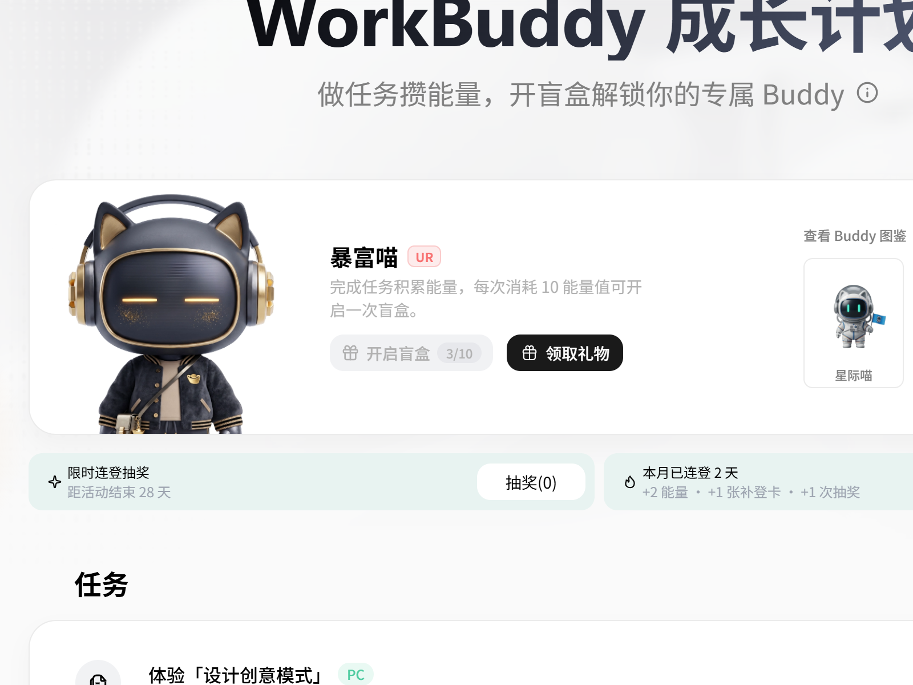
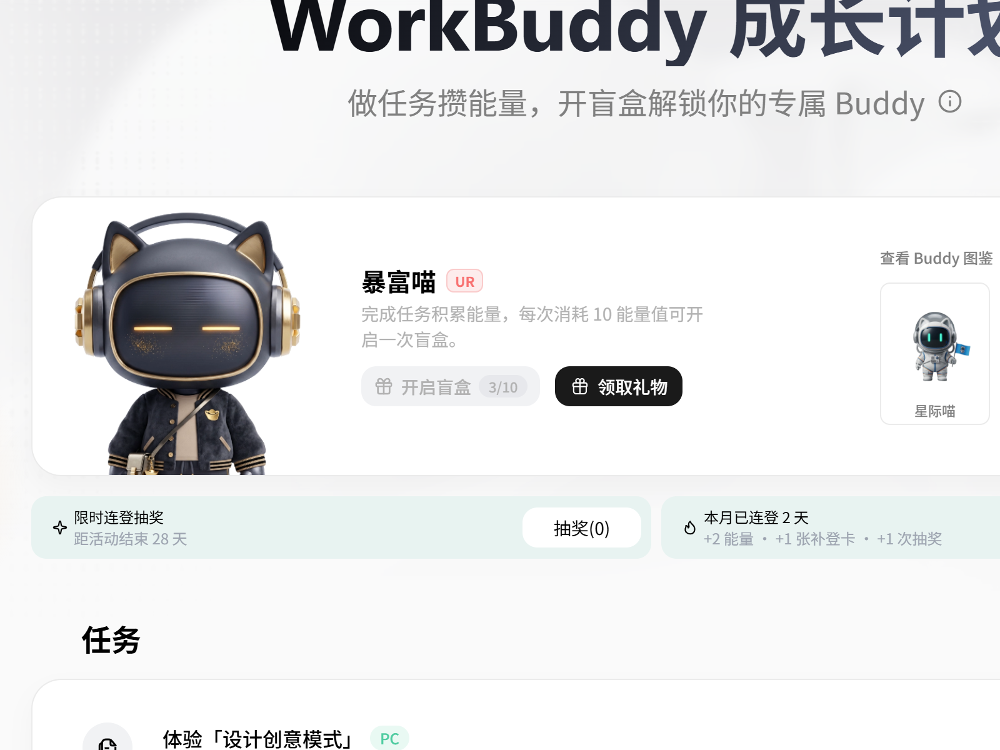

# BiDirectional LaTeX Editor

一款基于 PySide6 和 MathLive 的双向 LaTeX 公式编辑器，提供可视化 WYSIWYG 编辑和实时代码同步。

##  截图展示

### 主界面 - 亮色主题

*双向编辑：上方可视化公式区，下方 LaTeX 代码区，实时同步*

### 主界面 - 暗色主题

*支持亮色/暗色主题切换，保护视力*

### 自动补全功能

*输入 `\` 后跟命令名，智能提示 40+ 常用 LaTeX 命令*

### 矩阵格式化

*Ctrl+Shift+F 自动格式化矩阵环境*

### 收藏管理

*收藏常用公式，快速插入使用*

### 历史记录

*自动保存最近 50 条公式历史*

## 功能特性

### 核心功能
- **可视化编辑**：基于 MathLive 的所见即所得公式编辑器
- **实时同步**：公式区与 LaTeX 代码区双向实时同步
- **自动补全**：智能 LaTeX 命令自动补全（支持 40+ 常用命令）
- **矩阵格式化**：自动格式化矩阵环境（pmatrix, bmatrix, vmatrix 等）

### 高级功能
- **复制为图片**：一键复制公式为 PNG 图片（Ctrl+Shift+C）
- **导出功能**：支持导出 PNG 和 SVG（MathML）格式
- **历史记录**：自动保存最近 50 条公式历史
- **收藏管理**：收藏常用公式，快速插入
- **拖拽支持**：支持拖拽 .tex 文件到窗口打开
- **缩放控制**：Ctrl+滚轮缩放公式显示（12px-72px）
- **暗色主题**：支持亮色/暗色主题切换

### 编辑功能
- **智能括号**：自动补全括号配对
- **快捷键**：丰富的键盘快捷键支持
- **语法高亮**：LaTeX 代码区语法高亮（计划中）
- **中文界面**：完整的中文界面和提示

## 安装运行

### 环境要求
- Python 3.8+
- PySide6
- MathLive 0.111.1（已包含）

### 安装步骤

1. 安装依赖：
```bash
pip install PySide6
```

2. 下载 MathLive 库到 `mathlive/` 目录（已包含在发布包中）

3. 运行程序：
```bash
python "HaTeX _v1.4.0.py"
```

## 使用说明

### 基本操作

1. **输入公式**：在上方公式区直接输入，或使用虚拟键盘
2. **编辑代码**：在下方代码区直接编辑 LaTeX 代码
3. **自动补全**：在代码区输入 `\` 后跟命令名，按 Tab 或 Enter 选择
4. **格式化矩阵**：选中矩阵代码后按 Ctrl+Shift+F 格式化

### 快捷键

| 快捷键 | 功能 |
|--------|------|
| Ctrl+Shift+C | 复制为 PNG 图片 |
| Ctrl+Shift+E | 导出为 PNG |
| Ctrl+O | 打开 .tex 文件 |
| Ctrl+S | 保存为 .tex 文件 |
| Ctrl+D | 收藏当前公式 |
| Ctrl+Shift+F | 格式化矩阵 |
| Ctrl+= | 放大 |
| Ctrl+- | 缩小 |
| Ctrl+0 | 重置缩放 |
| Ctrl+滚轮 | 缩放公式 |

### 自动补全命令

支持 40+ 常用 LaTeX 命令的自动补全，包括：
- 分数：`\frac`
- 根号：`\sqrt`, `\sqrtn`
- 积分：`\int`, `\oint`
- 求和/求积：`\sum`, `\prod`
- 极限：`\lim`
- 希腊字母：`\alpha`, `\beta`, `\gamma`, ...
- 三角函数：`\sin`, `\cos`, `\tan`
- 对数：`\log`, `\ln`, `\exp`
- 矩阵：`\matrix`, `\bmatrix`, `\cases`
- 箭头：`\rightarrow`, `\leftarrow`, ...
- 集合运算：`\in`, `\subset`, `\cup`, `\cap`
- 比较运算符：`\le`, `\ge`, `\ne`, `\approx`

## 版本历史

### v1.4.0 (当前版本)
- ✨ 新增：复制为图片功能（PNG）
- ✨ 新增：导出 PNG/SVG 功能
- ✨ 新增：公式历史记录（最近 50 条）
- ✨ 新增：拖拽 .tex 文件打开
- ✨ 新增：常用公式收藏功能
- ✨ 新增：缩放控制（Ctrl+滚轮）
- ✨ 新增：暗色主题支持
- 🐛 修复：矩阵格式化添加多余行的问题
- 🐛 修复：自动补全光标偏移问题
- 🐛 修复：JS 模板注入漏洞
- 🐛 修复：textarea↔math-field 循环更新
- 🐛 修复：括号补全后不通知 Python
- 🔄 升级：MathLive v0.109.1 → v0.111.1

### v1.3.0
- 🐛 修复 7 个已知 bug
- 改进稳定性

### v1.2.2
- 初始稳定版本

## 已知问题

- **方向键问题**：在公式区（math-field）中，方向键可能无法正常工作。这是 MathLive 在 Qt WebEngine 环境下的已知限制，建议使用鼠标点击来移动光标。

## 技术栈

- **后端**：Python 3.8+ / PySide6 (Qt 6)
- **前端**：HTML5 / CSS3 / JavaScript
- **公式引擎**：MathLive 0.111.1
- **架构**：单文件应用（~950 行 Python + 嵌入式 HTML/JS/CSS）

## 项目结构

```
HaTeX/
├── HaTeX _v1.4.0.py    # 主程序（包含所有代码）
├── mathlive/            # MathLive 库文件
│   ├── mathlive.min.js
│   ├── mathlive-static.css
│   └── ...
├── hatex_history.json   # 历史记录（自动生成）
└── hatex_favorites.json # 收藏数据（自动生成）
```

## 开发者

**胡悠飏**  
中国科学技术大学 25 级少年班  
邮箱：youyanghu@mail.ustc.edu.cn

## 许可证

本项目采用 [MIT License](LICENSE) 开源协议。

## 反馈与建议

欢迎通过以下方式联系：
- **GitHub Issues**: 报告 bug 或提出功能建议
- **邮箱**: youyanghu@mail.ustc.edu.cn

---

**当前版本**: v1.4.0 | **最后更新**: 2026-10-13
